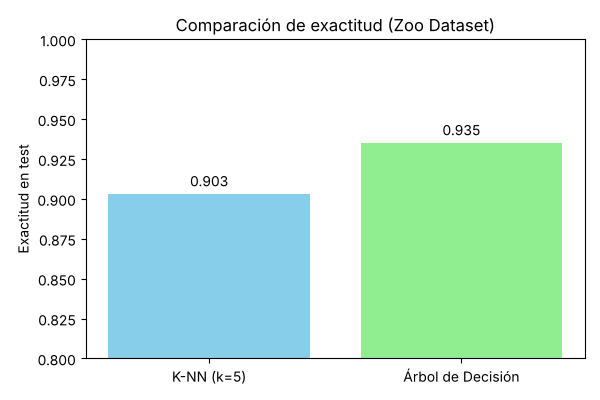

# C5_Aprendizaje_Automatico
Comparación de algoritmos K-NN y Árbol de Decisión usando el Zoo Dataset
# Resumen del Proyecto: Comparación de Algoritmos de Clasificación

Este proyecto forma parte de la clase 5 del curso de Aprendizaje Automático. El objetivo fue comparar dos algoritmos supervisados de clasificación — K-Nearest Neighbors (K-NN) y Árbol de Decisión — utilizando el Zoo Dataset, que contiene características de 101 animales y sus respectivas clases.

---

## Dataset Utilizado

- **Nombre**: Zoo Dataset
- **Fuente**: UCI Machine Learning Repository
- **Características**: 16 atributos binarios + nombre del animal + clase objetivo (`class_type`)
- **Preprocesamiento**: Se eliminaron las columnas `animal_name` y se dividieron los datos en entrenamiento (70%) y prueba (30%).

---

## Modelo 1: K-Nearest Neighbors (K-NN)

- **Preprocesamiento adicional**: Escalado de características con `StandardScaler`
- **Hiperparámetro**: `n_neighbors = 5`
- **Evaluación**:
  - Exactitud (accuracy) en test: **0.90**
  - Matriz de confusión: visualizada con `seaborn`
- **Ventajas**: Simplicidad, buen rendimiento
- **Desventajas**: Sensible al escalado, difícil de interpretar

---

## Modelo 2: Árbol de Decisión

- **Preprocesamiento**: No requiere escalado
- **Visualización**: Árbol generado con `plot_tree`
- **Evaluación**:
  - Exactitud (accuracy) en test: **0.94**
  - Matriz de confusión: visualizada con `seaborn`
- **Ventajas**: Alta interpretabilidad, visualización clara
- **Desventajas**: Puede sobreajustar si no se regula

---

## Comparativa de Modelos

| Métrica               | K-NN                      | Árbol de Decisión           |
|----------------------|---------------------------|-----------------------------|
| Exactitud (test)     | 0.90                      | 0.94                        |
| Interpretabilidad    | Baja                      | Alta                        |
| Sensible a escalado  | Sí                        | No                          |
| Visualización        | Matriz de confusión       | Matriz + Árbol de decisión  |

---

## Conclusión

Ambos modelos muestran fortalezas distintas: K-NN destaca en clases bien definidas, logrando predicciones perfectas en varias categorías. 
Sin embargo, su dependencia en la proximidad lo vuelve vulnerable en clases con vecinos diversos, como la clase 6. 
El Árbol de Decisión ofrece una mejor generalización en clases ambiguas, como la 6 y la 2, aunque presenta confusiones entre clases similares como la 4 y la 5. El Árbol de Decisión se destacó por su capacidad de interpretación y visualización.

---

**Autora:** Miriam Alicia Velazque · Tecnicatura Superior en Ciencia de Datos e IA (Politécnico Malvinas Argentinas)
